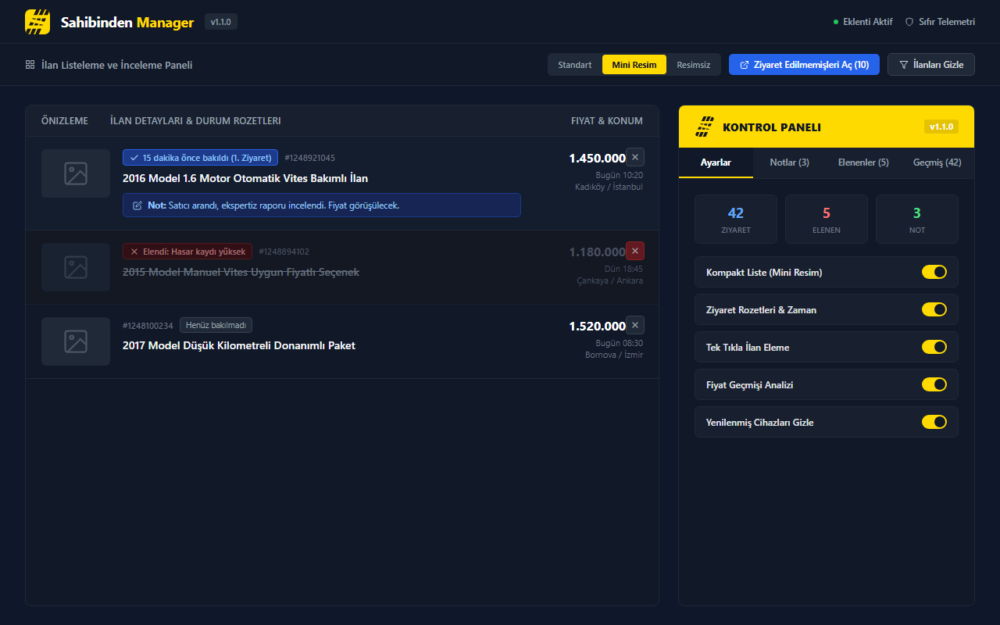

# Sahibinden Manager

[](https://github.com/fastfingertips/sahibinden-manager/releases)
[](https://github.com/fastfingertips/sahibinden-manager/actions)
[](https://github.com/fastfingertips/sahibinden-manager/blob/main/LICENSE)
[](https://github.com/fastfingertips/sahibinden-manager/blob/main/PRIVACY.md)

**Sahibinden Manager**, ilan arama ve inceleme süreçlerini hızlandırmak için geliştirilmiş, sıfır telemetri ve %100 yerel depolama odaklı açık kaynak bir tarayıcı eklentisidir (Chrome & Firefox).



---

## Özellik Özeti

| Modül                          | Açıklama                                                                                                                             |
| ------------------------------ | ------------------------------------------------------------------------------------------------------------------------------------ |
| **Kompakt Liste Görünümü**     | **Mini Resim** (hover ile 3.5x önizleme) ve **Resimsiz** (ultra kompakt tablo) modları ile tek ekranda çok daha fazla ilan inceleme. |
| **Ziyaret Takibi & Rozetler**  | İncelenen ilanları satır hizasını bozmadan ilk/son ziyaret zamanı ve ziyaret sayısı rozetleriyle otomatik işaretleme.                |
| **Tek Tıkla İlan Eleme**       | Arama listesi satırında veya detay sayfasında tek tıkla ilan eleme, isteğe bağlı eleme nedeni ekleme ve listeden gizleme.            |
| **İlan Filtreleme Penceresi**  | Elenen, ziyaret edilen, yenilenmiş cihaz (Yepy) ve reklam satırlarını ayrı bir filtre penceresinden anlık gizleme/gösterme.          |
| **Ziyaret Edilmemişleri Aç**   | Sayfadaki incelenmemiş ilanları tek tıkla veya `U` kısayoluyla arka plan sekmelerinde toplu açma.                                    |
| **Kişisel Not Defteri**        | İlan detayında not ekleme/düzenleme, arama listesinde not rozeti ve popup üzerinden tüm notları yönetme.                             |
| **Fiyat Geçmişi & Soru-Cevap** | Fiyat değişim özeti, soru-cevap yanıtlarını otomatik genişletme ve yapılandırılmış ilan verisini Markdown olarak kopyalama.          |
| **Fotoğraf İndirici & Klavye** | İlan görsellerini yüksek çözünürlükte (`x16`) indirme, `Yukarı/Aşağı` ok tuşları ve `Enter` ile hızlı gezinme.                       |

---

## Kurulum

### 1. Hazır Paket (GitHub Releases)

1. [Releases](https://github.com/fastfingertips/sahibinden-manager/releases) sayfasından tarayıcınıza uygun güncel `.zip` paketini indirin (`chrome` veya `firefox`).
2. Arşivi bir klasöre çıkartın.
3. Chrome / Brave / Edge adres çubuğuna `chrome://extensions` yazın, **Geliştirici Modu**'nu açın ve **Paketlenmemiş öğe yükle** ile çıkarttığınız klasörü seçin.

### 2. Kaynak Koddan Derleme

```bash
git clone https://github.com/fastfingertips/sahibinden-manager.git
cd sahibinden-manager
npm install
npm run build          # Chrome MV3 (.output/chrome-mv3)
npm run build:firefox  # Firefox (.output/firefox-mv2)
```

---

## Proje Mimarisi

```text
sahibinden-manager/
├── entrypoints/
│   ├── background.ts        # Sekme açma ve görsel indirme servis çalışanı
│   ├── content.ts           # Ana içerik betiği ve DOM gözlemleyici (AJAX uyumlu)
│   ├── content/             # Özellik modülleri (compactView, listingFilter, tracker, ui/, styles/)
│   └── popup/               # React 19 + Tailwind CSS v4 kontrol paneli
├── utils/                   # Tarih biçimlendirme, pano ve birim testleri
├── public/                  # Vektörel logo ve çoklu çözünürlük simgeleri
└── .github/workflows/       # CI kalite kapıları ve otomatik Release akışı
```

---

## Geliştirme ve Kalite Standartları

- **Altyapı:** [WXT](https://wxt.dev/), React 19, TypeScript, Tailwind CSS v4
- **Test & Analiz:** Vitest, ESLint, Prettier, `tsc --noEmit`, `jscpd`
- **Otomasyon:** Husky + `lint-staged`, GitHub Actions (Chrome & Firefox derleme doğrulaması), Dependabot

Katkıda bulunmak için [CONTRIBUTING.md](CONTRIBUTING.md) rehberini inceleyebilirsiniz.

---

## Gizlilik ve Lisans

- **Gizlilik:** Tüm veriler yalnızca tarayıcının yerel `chrome.storage.local` alanında tutulur; hiçbir uzak sunucuya veri aktarılmaz. Ayrıntılar için [PRIVACY.md](PRIVACY.md) dosyasına bakın.
- **Lisans:** [MIT](LICENSE)

**Yasal Uyarı:** Bu proje bağımsız bir açık kaynak geliştirici aracıdır. sahibinden.com (Sahibinden Bilgi Teknolojileri Paz. ve Tic. A.Ş.) ile herhangi bir resmi bağı, ortaklığı veya sponsorluğu bulunmamaktadır.
